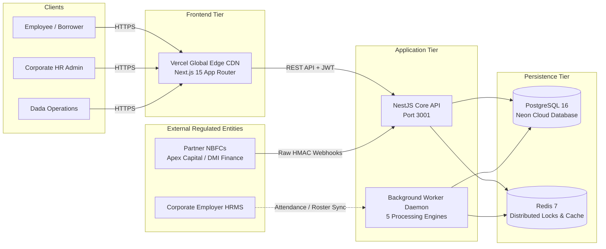

# Dada Advisory — System Architecture & Design Documentation

> **Regulatory Status**: Dada Advisory operates strictly as a **Lending Service Provider (LSP)** in compliance with the Reserve Bank of India (RBI) Digital Lending Guidelines. Dada Advisory maintains **zero custody of funds**. All disbursements and repayments are executed directly between regulated NBFC partners, corporate employers, and borrower bank accounts.

---

## Documentation Navigation

This repository contains comprehensive architectural specifications:

- **Full System Architecture**: [docs/architecture.md](file:///Users/shashankg/.gemini/antigravity/scratch/dada-advisory/docs/architecture.md)
  - Monorepo Topology & Multi-Tier Service Boundaries
  - Frontend Architecture (Next.js 15, App Router, Portal Routing, Client API)
  - Backend Architecture (NestJS Modules, State Machines, Webhook HMAC Security)
  - Background Worker Architecture (5 Continuous Engines, Distributed Crash Recovery)
  - Financial Mathematics & Integer-Paise Formulation
  - Multi-Tenant Security & Regulatory Compliance
- **Database Migration Runbook**: [docs/database-migration-runbook.md](file:///Users/shashankg/.gemini/antigravity/scratch/dada-advisory/docs/database-migration-runbook.md)
- **Staging Deployment Guide**: [docs/staging-deployment-guide.md](file:///Users/shashankg/.gemini/antigravity/scratch/dada-advisory/docs/staging-deployment-guide.md)

---

## Architecture at a Glance

---

## Core Technical Specifications

| Component | Technology | Responsibilities | Deployment Host |
| :--- | :--- | :--- | :--- |
| **Frontend Web** | Next.js 15 (App Router), React 19, Tailwind CSS | Employee portal, Corporate HR portal, Dada Admin console, public marketing | **Vercel** (`https://dada-advisory-web.vercel.app`) |
| **Backend API** | NestJS 10, TypeScript, Passport JWT | Authentication, lending state machine, NBFC webhooks, integer-paise math | **Railway** (`https://api-production-69ef35fa.up.railway.app`) |
| **Background Worker** | Node.js, TypeScript, Distributed Leases | Outbox processing, attendance sync, cutoff cycle freezing, remittance matching | **Railway / Docker** |
| **Database** | PostgreSQL 16, Prisma ORM | Multi-tenant relational schema (30+ tables), strict foreign key referential integrity | **Neon Managed Cloud** |
| **Cache & Locks** | Redis 7, Redis Sentinel / Upstash | Distributed lease locking, sliding-window rate limiting, session revocation | **Railway / Cloud Redis** |
| **Contracts** | TypeScript (`@dada/contracts`) | Shared domain types, financial math engine, loan state machine invariants | Monorepo internal workspace |

For in-depth diagrams and component breakdowns, please refer to [docs/architecture.md](file:///Users/shashankg/.gemini/antigravity/scratch/dada-advisory/docs/architecture.md).
