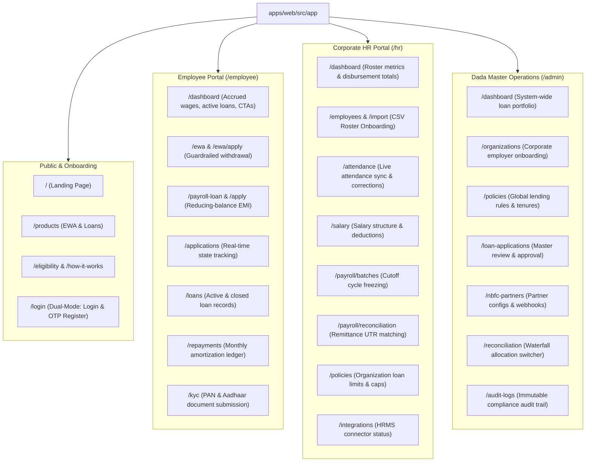
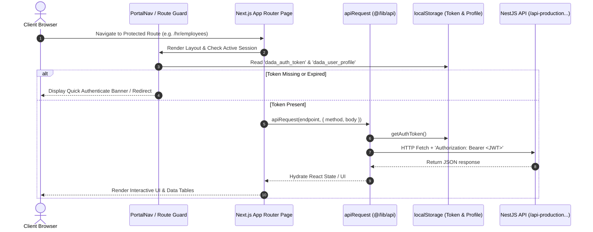
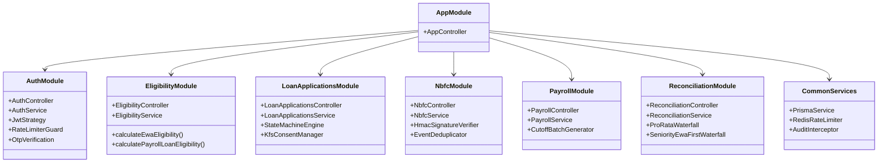
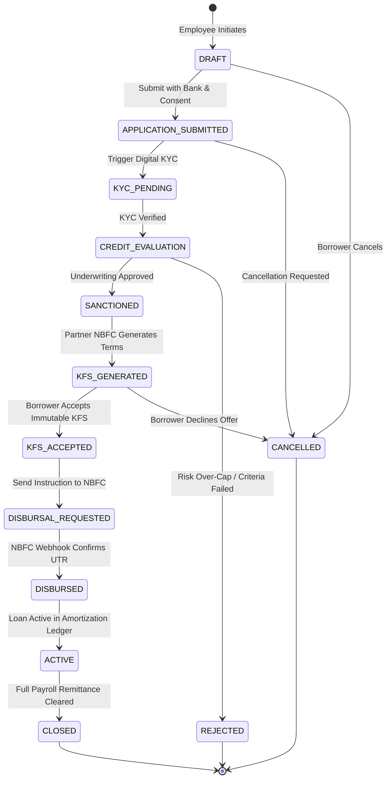
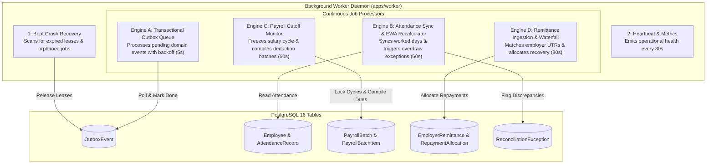

# Dada Advisory — Full-Stack LSP Platform Architecture

> **Regulatory & Compliance Notice**: Dada Advisory operates strictly as a **Lending Service Provider (LSP)** in full adherence to the Reserve Bank of India (RBI) Digital Lending Guidelines. Dada Advisory maintains **zero custody of borrower or repayment funds**. All disbursements are made directly by RBI-registered NBFC partners into the employee's verified salary account, and repayments are collected via employer payroll deductions directly into NBFC designated escrow accounts.

---

## 1. High-Level System Architecture

Dada Advisory is structured as a high-performance monorepo utilizing **pnpm workspaces** and **Turbo**, separating the application into decoupled frontend, backend, background worker, and shared domain libraries.

```mermaid
flowchart TD
    subgraph Clients["Clients & External Actors"]
        Emp[Borrower / Employee]
        HR[Corporate Employer HR]
        Admin[Dada Platform Operations]
        NBFC_Partner[Regulated NBFC Partners<br/>Apex Capital / DMI Finance]
    end

    subgraph Frontend["Frontend Tier (Vercel CDN)"]
        Web[Next.js 15 App Router<br/>apps/web]
        PubRoutes[Public Marketing & Calculators]
        EmpPortal[Employee Self-Service Portal]
        HRPortal[Corporate HR Management Portal]
        AdminPortal[Master Dada Admin Console]
        Web --> PubRoutes
        Web --> EmpPortal
        Web --> HRPortal
        Web --> AdminPortal
    end

    subgraph API_Gateway["Backend API Tier (Railway)"]
        API[NestJS Core API<br/>apps/api:3001]
        RateLimiter[Redis Sliding-Window<br/>Rate Limiter & Guard]
        AuthGuard[JWT & RBAC Guards]
        HMACGuard[NBFC Raw-Body<br/>HMAC-SHA256 Guard]
        API --> RateLimiter
        API --> AuthGuard
        API --> HMACGuard
    end

    subgraph Worker_Tier["Asynchronous Worker Tier (Railway / Docker)"]
        Worker[Background Worker Daemon<br/>apps/worker]
        OutboxEngine[Transactional Outbox Processor]
        AttendanceEngine[Attendance Sync & EWA Recalculator]
        CutoffEngine[Payroll Cutoff & Cycle Freezer]
        RemittanceEngine[Waterfall Remittance Allocator]
        CrashRecovery[Distributed Lease Crash Recovery]
        Worker --> OutboxEngine
        Worker --> AttendanceEngine
        Worker --> CutoffEngine
        Worker --> RemittanceEngine
        Worker --> CrashRecovery
    end

    subgraph Data_Tier["Persistence & Infrastructure Tier"]
        DB[(Cloud PostgreSQL 16<br/>Neon Managed DB)]
        RedisCache[(Redis 7<br/>Locks, Limits & Cache)]
    end

    subgraph Shared_Packages["Shared Monorepo Packages"]
        Contracts["@dada/contracts<br/>State Machine, Types, Math"]
        DatabasePkg["@dada/database<br/>Prisma Client & Migrations"]
        UIPkg["@dada/ui<br/>Shared Design System"]
    end

    Emp -->|HTTPS / Browsers| Web
    HR -->|HTTPS / Browsers| Web
    Admin -->|HTTPS / Browsers| Web
    NBFC_Partner -->|HMAC Webhooks| API

    Web -->|REST / JSON + JWT| API
    API -->|Prisma ORM| DB
    API -->|Key-Value / Locks| RedisCache
    Worker -->|Prisma Client| DB
    Worker -->|Distributed Locks| RedisCache

    API -.-> Contracts
    API -.-> DatabasePkg
    Web -.-> Contracts
    Web -.-> UIPkg
    Worker -.-> Contracts
    Worker -.-> DatabasePkg
```

---

## 2. Frontend Architecture (`apps/web`)

The frontend is built on **Next.js 15 (App Router)** and **React 19**, styled with **Tailwind CSS**, and architected around three secure role-based portals plus public marketing/onboarding funnels.

### A. Routing & Portal Hierarchy

### B. Client Architecture & Data Flow

### C. Key Frontend Features
- **Independent OTP Employee Onboarding**: Two-stage registration verifies corporate roster membership before accepting verification OTP.
- **Dual Dynamic Calculators**: Interactive Earned Wage slider and reducing-balance EMI tenure simulator with real-time statutory limits.
- **Role-Based Isolation**: Three strict portal shells preventing cross-role navigation or unauthorized interface rendering.
- **Statutory Alert System**: Clear warnings for payroll freeze windows, notice-period ineligibility, and regulatory interest disclosures.

---

## 3. Backend Architecture (`apps/api` & `apps/worker`)

The backend is built using **NestJS 10**, strictly adhering to domain-driven modular boundaries, enterprise design patterns, and dependency injection.

### A. Modular Structure & Subsystems

### B. The 11-State Lending State Machine

Loan applications undergo strict lifecycle transitions enforced centrally by `@dada/contracts`:

### C. Background Worker Architecture (`apps/worker`)

The background worker daemon operates independently from the HTTP API to handle asynchronous processes, reconciliation, and batch execution:

---

## 4. Financial Calculation Engine & Mathematical Invariants

All calculations strictly use **integer paise** (where ₹1 = 100 paise) to eliminate floating-point rounding errors:

### 1. Earned Wage Access (EWA)
- **Daily Net Wage**:
  $$\text{Daily Net Wage} = \left\lfloor \frac{\text{Monthly Net Salary}}{\text{Total Payable Days}} \right\rfloor$$
- **Gross Earned Wage**:
  $$\text{Gross Earned Wage} = \text{Daily Net Wage} \times \text{Approved Days Worked}$$
- **Available EWA Cap**:
  $$\text{Cap} = \min\left( \text{Policy \%} \times \text{Gross Earned} - \text{Current Cycle Withdrawn} - \text{Active EMIs}, \; \text{Max Policy Cap} \right)$$
- **Regulatory Guardrails**:
  - Minimum withdrawal: ₹1,000 (100,000 paise)
  - Maximum withdrawal: ₹50,000 (5,000,000 paise)
  - Maximum 2 withdrawals per salary cycle
  - Next-cycle full deduction recovery

### 2. Corporate Payroll Term Loan (EMI)
- **Reducing-Balance Monthly Installment**:
  $$\text{EMI} = \left\lfloor \frac{P \cdot r \cdot (1 + r)^n}{(1 + r)^n - 1} \right\rfloor$$
  where $P$ is principal in paise, $r = \frac{\text{APR}}{12 \times 100}$, and $n$ is tenure in months (3, 6, 9, 12).
- **FOIR Enforcement**:
  $$\text{Total Monthly Obligations} \le \text{FOIR Cap (e.g. 50\%)} \times \text{Monthly Net Salary}$$

### 3. Remittance Allocation Waterfall
When an employer remits funds for payroll deductions, the engine resolves payments via one of two configurable strategies:
- **`PRO_RATA_EQUAL`**: Proportional distribution across all outstanding employee obligations during partial remittance.
- **`SENIORITY_EWA_FIRST`**: Seniority prioritization settling short-term EWA advances in full before amortizing term loans.

---

## 5. Security & Multi-Tenant Isolation

1. **Multi-Tenant Scoping**: All employee, salary, attendance, loan, and batch queries are scoped strictly by `organizationId`. A corporate HR admin can never view or modify data outside their own corporate tenant.
2. **NBFC Webhook HMAC Verification**: Inbound webhooks from NBFCs require raw-body HMAC-SHA256 signature verification via `crypto.timingSafeEqual` with a 5-minute replay window.
3. **Event Deduplication**: Webhook event IDs are stored with unique constraints in `NbfcWebhookEvent` to prevent duplicate processing.
4. **Rate Limiting with Memory Fail-Safe**: Sliding-window rate limiter on authentication endpoints backed by Redis, automatically falling back to memory during network blips to prevent denial-of-service.
5. **Single-Use Cryptographic Tokens**: Password reset tokens and registration OTPs are SHA-256 hashed, single-use, and time-bounded.
