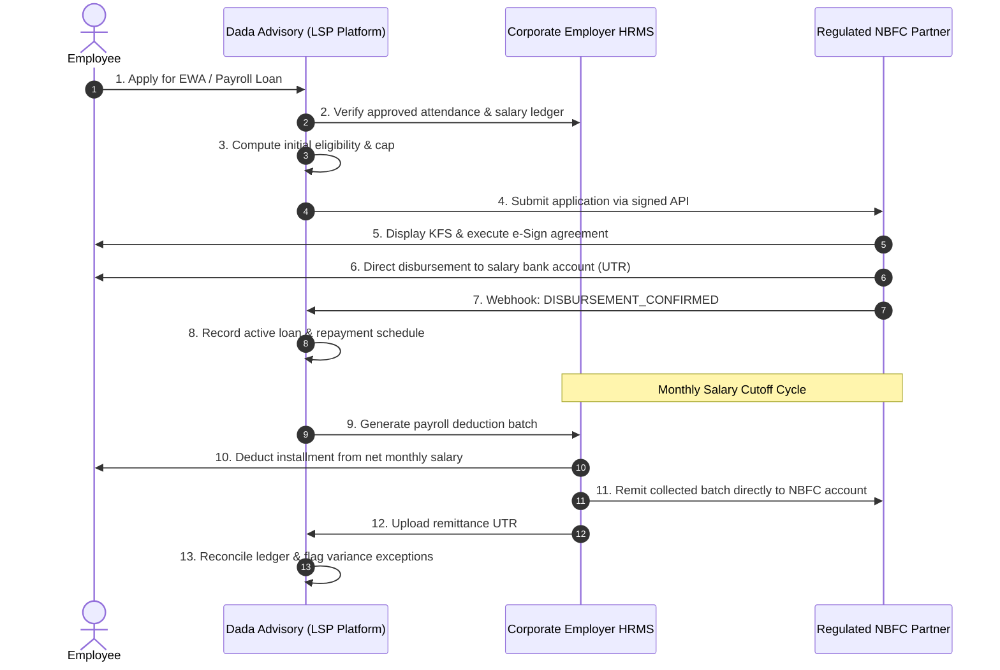
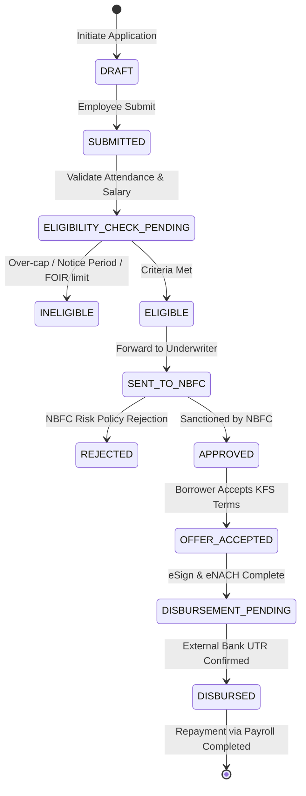

# Dada Advisory — Architecture & System Overview

## 1. System Context & Business Model

Dada Advisory operates strictly as a **Lending Service Provider (LSP)** in compliance with the Reserve Bank of India (RBI) Digital Lending Guidelines. 

### Mandatory Statutory Boundary
- **Zero Custody of Funds:** Dada Advisory does **not** receive, hold, pool, route, or transfer borrower funds.
- **Direct NBFC Disbursement:** Partner NBFCs (e.g. Apex Capital Finance Ltd) perform final underwriting, generate Key Fact Statements (KFS), sanction loan agreements, and disburse money **directly** into the employee's salary bank account.
- **Direct Employer Remittance:** Employers deduct advance repayments on salary day and remit funds **directly** to the partner NBFC designated escrow account.

---

## 2. Loan Application State Machine

---

## 3. Financial Calculation Rules

### Earned Wage Access (EWA)
- **Daily Net Wage:** $\text{Daily Net Wage} = \lfloor \frac{\text{Monthly Net Salary}}{\text{Total Payable Days}} \rfloor$
- **Gross Earned Wage:** $\text{Daily Net Wage} \times \text{Approved Days Worked}$
- **Available EWA Cap:** $\min(50\% \times \text{Gross Earned Wage} - \text{Already Withdrawn} - \text{Active EMIs}, \text{Policy Max})$
- **Notice Period / Terminated Employees:** Explicit **ZERO** eligibility.
- **Attendance Correction Overdraw Rule:**
  1. Attendance reduction recalculates remaining eligibility.
  2. If prior disbursed withdrawals exceed new cap, an `ATTENDANCE_CORRECTION_OVERDRAW` reconciliation exception is generated.
  3. Disbursed loan and borrower repayment obligations remain strictly preserved.

### Corporate Payroll Personal Loans (EMI)
- **Reducing-Balance Formula:**
  $$\text{EMI} = \frac{P \cdot r \cdot (1 + r)^n}{(1 + r)^n - 1}$$
  where $P$ is principal in integer paise, $r$ is monthly interest rate ($\frac{\text{APR}}{1200}$), and $n$ is tenure in months.
- **FOIR Check:** Total monthly EMI obligations must not exceed corporate policy cap (default 50%).
